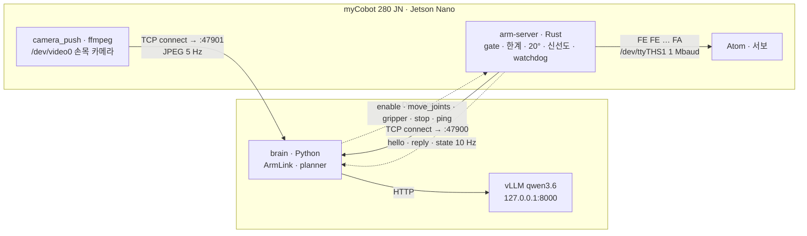

# mycobot-link

DGX Spark(vLLM)와 myCobot 280 JN을 ROS 없이 잇는 프로젝트입니다. 세 프로그램으로 나뉩니다.

| 위치 | 디렉터리 | 언어 | 역할 |
| --- | --- | --- | --- |
| DGX Spark | `brain/` | Python (표준 라이브러리만) | 카메라 프레임과 팔 상태를 받아 vLLM에 동작을 묻고, 스킬 요청을 보낸다 |
| Jetson Nano | `arm-server/` | Rust | 모든 안전 검사를 하고, 통과한 명령만 `/dev/ttyTHS1`로 보낸다 |
| Jetson Nano | `camera-push/` | Python 3.8 표준 라이브러리 + `ffmpeg` | 손목 카메라 `/dev/video0`의 JPEG를 Spark로 보낸다. 팔에는 닿지 않는다 |



Jetson이 Spark에 접속하고(공유기 NAT 때문), 팔 연결 하나로 명령·응답·상태가 오갑니다. 카메라 프레임은 두 번째 연결로 따로 옵니다. 메시지 형식은 [`schema/PROTOCOL.md`](schema/PROTOCOL.md)에 있습니다.

핵심 원칙은 세 가지입니다.

- **기본은 dry-run입니다.** 팔 서버는 `--live`를 주고 `yes`를 입력해야만 실제 팔에 명령을 보냅니다.
- **안전 판단은 팔 서버가 합니다.** 관절 한계, 측정값에서 20° 넘는 이동, 속도 상한, 측정값 노화를 팔 서버가 매번 검사합니다. vLLM의 출력과 두뇌 쪽 검사는 제안일 뿐입니다.
- **두뇌가 조용해지면 팔이 멈춥니다.** gate가 열린 동안 두뇌에게서 500 ms 동안 아무 메시지도 오지 않으면 팔 서버가 `stop()`하고 gate를 닫습니다.

## 빠른 시작 (한 PC, dry-run)

터미널 1에서 팔 서버를 띄웁니다. 두뇌가 뜰 때까지 1초마다 다시 접속합니다.

```bash
cd arm-server && cargo run -- --brain 127.0.0.1:47900
```

터미널 2에서 두뇌 명령을 보냅니다. 명령마다 새로 bind하고 팔 서버가 다시 접속하길 기다립니다. dry-run 팔은 목표로 순간이동만 합니다.

```bash
cd brain && uv sync --extra dev
uv run mycobot-brain --host 127.0.0.1 status
uv run mycobot-brain --host 127.0.0.1 move-joints 10 0 0 0 0 0
uv run mycobot-brain --host 127.0.0.1 move-joints 40 0 0 0 0 0   # 측정값 10°에서 30° → 거부
```

## Spark와 Jetson에서

Jetson 바이너리는 두 가지 방법으로 만들 수 있습니다. 연구실 Nano에는 `cargo`가 있어서 그 자리에서 빌드하면 약 1분 걸립니다(2026-10-27 실측).

```bash
cd arm-server && cargo build --release --locked
```

다른 PC에서 정적 musl 바이너리를 만들어 옮길 수도 있습니다. 이 바이너리는 Jetson의 glibc(2.31)와 무관합니다. Nano에는 `gh`가 없어서 release `v0.1.0`의 바이너리를 바로 받을 수는 없습니다.

```bash
cd arm-server
rustup target add aarch64-unknown-linux-musl
cargo build --release --target aarch64-unknown-linux-musl
scp target/aarch64-unknown-linux-musl/release/mycobot-arm <jetson>:~/
```

```bash
# Spark: 두뇌. vLLM이 떠 있어야 ask가 동작한다
cd brain && uv sync
uv run mycobot-brain status
uv run mycobot-brain ask "베이스를 왼쪽으로 조금 돌려"             # 제안만 출력
uv run mycobot-brain ask "베이스를 왼쪽으로 조금 돌려" --execute   # 제안을 팔 서버로 보냄
```

```bash
# Jetson: 팔 서버. 처음에는 dry-run으로 연결만 확인한다
./mycobot-arm --brain 210.123.42.157:47900
./mycobot-arm --brain 210.123.42.157:47900 --live   # 실제 팔. yes 입력 필요
```

`--live`는 vendor ROS 노드·`mycobot-control`과 같은 `/tmp/mycobot_lock`을 잡습니다. 따라서 이들과 동시에 실행할 수 없습니다.

## 카메라를 보고 움직이기

Jetson에서 카메라 전송을 띄웁니다. 팔 서버와 함께 돌아도 되고, 시스템 `python3`(3.8)와 `ffmpeg`만 씁니다.

```bash
python3 camera-push/camera_push.py --brain 210.123.42.157:47901   # /dev/video0, 640x480, 5 Hz
```

Spark에서는 먼저 vLLM이 카메라 화면을 제대로 읽는지 봅니다. `look`은 팔 연결이 없어도 됩니다. 프레임은 `runs/`에 저장됩니다.

```bash
uv run mycobot-brain look                                  # 한 장 저장 + vLLM 묘사
uv run mycobot-brain look "그리퍼 바로 아래에 뭐가 있어?"
uv run mycobot-brain act "흰 테이프 롤이 화면 가운데 오게 해"            # 첫 한 걸음 제안만
uv run mycobot-brain act "흰 테이프 롤이 화면 가운데 오게 해" --execute  # 보고-움직이기 반복
```

`act`는 매 라운드마다 팔이 멈춘 뒤 도착한 프레임을 vLLM에 보냅니다. 두 번째 라운드부터는 직전 프레임도 함께 보냅니다. vLLM은 관절 변화량(delta) 한 번을 고르고, 두뇌는 **측정한 관절각 + delta**를 목표로 보냅니다. 끝나는 조건은 vLLM이 `done`이라고 하거나, `--steps`(기본 5)를 다 쓰거나, 어느 쪽에서든 거부가 나올 때입니다. 끝나면 gate를 닫습니다.

| 옵션 | 기본 | 뜻 |
| --- | --- | --- |
| `--max-step` | 5° | 한 라운드에 관절 하나가 바뀔 수 있는 최대량. 넘으면 잘라서 보내지 않고 루프를 멈춥니다 |
| `--max-total` | 30° | 시작 자세에서 이만큼 벗어나는 목표가 나오면 멈춥니다 |
| `--lock 2,3` | 없음 | 움직이면 안 되는 관절 |
| `--speed` | 10 | `move_joints` 속도 |
| `--settle` | 1.5 s | 보낸 뒤 다음 프레임을 받기 전 기다리는 시간(실측 근거 없음) |
| `--camera` | `wrist` | 프롬프트에 카메라 위치를 손목/고정 중 무엇으로 알릴지 |

`--steps`는 이동 횟수입니다. 마지막 이동 뒤의 화면은 다시 보지 않습니다.

관절 부호가 화면을 어느 쪽으로 움직이는지는 vLLM에 알려 주지 않습니다. 이 팔에서 재지 않았기 때문입니다. vLLM은 직전 한 걸음 전후의 두 장을 비교해서 방향을 판단해야 합니다. 이 두뇌 쪽 한계는 엉뚱한 제안을 일찍 멈추는 장치일 뿐이고, 마지막 검사는 여전히 팔 서버가 합니다.

## 집어서 옮기기 (`pick-place`)

```bash
uv run mycobot-brain pick-place "빨간 블록을 잡아서 갈색 상자 안에 넣어" --calib sim_calib.json            # 계획만
uv run mycobot-brain pick-place "빨간 블록을 잡아서 갈색 상자 안에 넣어" --calib sim_calib.json --execute  # 움직임
```

`act`와 달리 vLLM은 관절각을 고르지 않습니다. **어디에 무엇이 있는지**(집을 물체와 놓을 곳의 상자 또는 점, 0–1000 격자)와 **한 단계가 됐는지**(잡혔나, 상자 안에 들어갔나)만 답합니다. 나머지는 두뇌의 기하 계산입니다. 픽셀 → 카메라 광선(K와 **측정한** 관절각의 FK) → 높이를 아는 평면(블록은 탁자 + 블록 절반, 상자는 테두리) → 베이스 좌표 xyz → IK(감쇠 최소제곱) 순서입니다. 깊이 영상을 쓰지 않으므로 깊이 카메라가 없는 실제 팔에도 같은 코드가 맞습니다.

순서: 관찰 자세 → 둘 다 찾기 → 블록 위로 카메라를 옮겨 다시 보고 위치 보정 → 6 cm 위 → 내려가기 → 닫기 → 들기 → vLLM "잡혔나?"(아니면 관찰 자세에서 다시, `--attempts` 기본 2) → 상자 위에서 다시 보고 보정 → 내리기 → 열기 → 올리기 → 관찰 자세 → vLLM "상자 안에 있나?". 경유점은 관절마다 8° 이하(`--max-step`)이고, 측정값이 도착한 뒤에 다음 경유점을 보냅니다. vLLM 응답을 기다리는 몇 초 동안에도 `ArmLink`의 100 ms 핑이 감시 타이머를 채웁니다.

`--calib` 파일에는 기구학 사슬(펌웨어 각도 기준), 카메라 K, 탁자 높이, 블록 크기, 상자 크기·테두리 높이, 관찰 자세, 그리퍼 열림·닫힘 값이 들어 있고, 물체 위치는 없습니다. 실행마다 `runs/pp-<시각>/events.jsonl`(모든 줄에 `wall` 유닉스 초)과 vLLM이 본 이미지를 남깁니다(`--record`나 `MYCOBOT_RUNS_DIR`로 위치 변경).

## 서랍 (`drawer`)

```bash
uv run mycobot-brain drawer "노란색 원뿔 찾아서 꺼내 줘" --calib sim_calib_drawers.json --execute
uv run mycobot-brain drawer "파란 큐브를 가운데 서랍에 넣어" --calib sim_calib_drawers.json --execute
uv run mycobot-brain drawer "왼쪽 아래 서랍에 있는 물건을 꺼내 줘" --calib sim_calib_drawers.json --execute
```

3×3 서랍장(`r{행}c{열}`, 행 0이 아래, 열 0이 로봇의 왼쪽)입니다. 손잡이 위치, 당기는 방향과 거리, 서랍 바닥 높이와 안쪽 크기, 물체 목록(모양별 높이와 잡는 높이), 건네주는 곳은 calib 파일(`cabinet`, `catalogue`, `handover`)에 있습니다. 서랍에 무엇이 들어 있는지는 없습니다.

- **vLLM이 정하는 것:** 명령 읽기(넣기/꺼내기/찾기, 물체, 서랍), 서랍장 사진에서 빠져나온 서랍 칸의 bbox와 다음에 열 서랍, 열린 서랍 안의 물체(색, 모양, bbox)와 찾는 물체가 그중 어느 것인지, 잡혔나·건넸나·넣었나. 서랍 안은 비스듬히 본 사진(`--view tilted`, 기본)으로 묻습니다.
- **코드가 하는 것:** 서랍장 사진의 bbox가 어느 서랍인지 정하기(각 서랍이 다 열렸을 때의 칸을 측정 각도로 사진에 투영해 가장 많이 겹치는 것), 손잡이를 calib의 방향(열마다 다른 수평 방향, 집게가 손잡이 위아래를 잡음)으로 잡고 당기는 축을 따라 곧게 당기기·밀기, 픽셀 → 광선 → 서랍 바닥 + 그 모양의 절반 높이 평면 → IK.
- **물체가 없을 때:** 찾기는 연 서랍을 닫고 다음 서랍으로 넘어갑니다. 끝나면 서랍장 사진으로 이번 실행에서 연 서랍이 모두 닫혔는지 확인합니다.
- **기록:** 모든 단계를 `events.jsonl`과 vLLM이 본 이미지로 남깁니다(`runs/dr-<시각>/`).

## 검증 상태 (2026-10-28)

- 확인함: 팔 서버의 직렬 프레임 11종이 pymycobot 4.0.7이 실제로 쓰는 바이트와 같고, `get_angles` 응답도 pymycobot과 같은 값으로 읽힘(`arm-server/tests/golden.rs`, pty 녹화). Rust 테스트 28개, Python 테스트 32개(실제 Rust 서버와의 dry-run 연동 포함). aarch64 정적 바이너리가 Spark에서 실행되고 두뇌 CLI와 dry-run으로 연결됨.
- 확인함 (실제 네트워크, dry-run): Jetson Nano(eth0 `192.168.0.77`, 공유기 NAT 뒤)의 팔 서버가 Spark `:47900`에 접속했습니다. Spark에서 본 접속 주소는 공유기 바깥 주소 `222.111.164.53`이었습니다. status, 5° 이동 수락, 25° 차이 이동 거부가 모두 기대대로 나왔습니다. 요청→응답 왕복은 50회 중앙값 0.88 ms, p90 1.30 ms, 최대 1.70 ms였습니다. 핑을 멈추자 watchdog이 515 ms에 gate를 닫았습니다. 양쪽 로그의 순서가 일치합니다.
- 확인함 (2026-10-28, 한 PC): `camera_push.py --test-pattern`(ffmpeg 시험 화면)이 보낸 640×480 프레임 10장이 모두 PIL로 디코딩됨. `mycobot-brain act --execute`가 실제 Rust dry-run 팔 서버, ffmpeg 카메라, 가짜 vLLM과 함께 두 걸음 이동 후 `done`으로 끝남(`tests/test_e2e_rust.py`). Python 테스트 54개.
- 확인함 (2026-10-28, Spark): vLLM `qwen3.6`이 이미지 입력을 받음. 320×240 시험 이미지(빨간 원·파란 사각형)를 맞게 묘사했고, 첫 요청 16.4 s, 같은 이미지 반복 시 약 332 ms.
- 확인함 (2026-10-28, 실제 카메라 + dry-run 팔): Jetson `/dev/video0`(손목 카메라) → Spark `:47901`. ffmpeg가 Jetson CPU 약 22~24%를 씁니다. `look` 3회는 프레임 38.7~39.5 KB, vLLM 1.55~1.74 s였습니다. 묘사의 물체·위치(흰 테이프 롤이 가운데에서 조금 왼쪽 아래, 왼쪽 그리퍼, 오른쪽 케이블·어댑터)는 맞았지만, 흰 어댑터의 상표는 매번 다르게 지어냈습니다. `act --execute --steps 3`(dry-run)은 라운드마다 vLLM 1.85~2.38 s가 걸렸고, J1 +2~3°, J2 −2~3°를 보낸 뒤 step 한도로 끝났습니다.
- 확인함 (같은 날, 같은 프레임 3장): `act` 한 번의 vLLM 시간은 출력 길이가 좌우합니다. 지금 프롬프트는 출력 124~148토큰에 1.67~1.97 s(입력 641토큰)였습니다. "seen·reason을 15단어 이내로"를 붙이면 82토큰에 1.16~1.21 s였습니다. 다만 그 한 줄만으로 제안이 J1 +3°에서 J2 +3°·J5 +3°로 바뀌었습니다. 모델이 관절 방향을 모른 채 추측한다는 뜻이라, 프롬프트는 바꾸지 않았습니다.
- 확인함 (2026-11-01, Spark, G1): Isaac Lab 시뮬레이션의 손목 카메라 프레임 40장(관찰 자세 20, 근접 20)에서 `qwen3.6`이 찍은 빨간 블록·갈색 상자 위치를 시뮬레이터 정답과 비교했습니다(`tools/g1_grounding.py`). 0–1000 격자 bbox가 가장 좋았습니다. 블록은 중앙값 4.2 px(평면에서 0.17 cm), p90 9.4 px(0.28 cm)였고, 상자 테두리 중심은 중앙값 2.3 px(0.10 cm), p90 10.4 px(0.46 cm), 최대 1.06 cm였습니다. 같은 격자에서 점(point)으로 받으면 블록 중앙값이 6.2 px로 조금 나빴습니다. 픽셀 좌표를 달라고 하면 모델이 그래도 0–1000 값으로 답해서 대부분 화면 밖이 됐습니다. Qwen3-VL 계열의 습관입니다. 동시 요청 4개에서 응답 시간은 중앙값 2.75 s였습니다. 시작 장면 5장에 '상자 안에 있나?'를 묻자 모두 아니라고 답했고, 같은 근접 사진 두 장에 '잡혔나?'를 묻자 모두 아니라고(아직 탁자 위) 답했습니다.
- 확인함 (2026-11-01, 계산만): 두뇌의 FK가 시뮬레이터 `fk_check` 다섯 자세의 TCP·카메라 위치와 1 µm 안에서 같습니다. 시뮬레이터 배치 구역에서 뽑은 무작위 장면 1100개를 가짜 팔·가짜 vLLM으로 돌리면 모두 블록 중심 3 mm 안에서 잡고 상자 중심 3 mm 안에서 놓습니다.
- 확인함 (2026-11-01, G3, Spark 두뇌 + rtx5090 Isaac Lab): `pick-place --execute`가 10개 배치(seed 0–9) 모두에서 블록을 상자에 넣었습니다. 경로는 두뇌 → 바꾸지 않은 Rust 팔 서버 `--live` → fw_emu pty → 시뮬레이터이고, 물리 파지만 썼습니다. 판정은 실행이 끝난 뒤 시뮬레이터 정답입니다. 블록이 `in_box`에 있고, 속도 0 m/s, 그리퍼 100(열림)이었습니다. 코드는 seed 0 전과 같습니다. 실행마다 35–39 s(중앙값 37.0 s), vLLM 호출 5번(중앙값 0.99 s, 최대 2.23 s), 모두 첫 시도에 잡았습니다. 상자 테두리 중심 추정 오차는 관찰 자세에서 0.1–8.5 mm, 근접에서 1.5–6.6 mm였습니다(`tools/g3_sim_run.sh`, `tools/g3_score.py`; 기록 `/home/hkim/mycobot-sim/runs/g3_s0N/`). vLLM의 "잡혔나?"와 "상자 안에 있나?"는 10번 모두 예였고 정답과 같았습니다. 실패 장면에서 예라고 잘못 답하는지는 이 실행으로 알 수 없습니다.
- 확인함 (2026-11-01, D2, 시뮬레이터 사진만): sim-scene이 찍은 열린 서랍 사진 18장(비스듬히·위에서 각각)과 서랍장 사진 10장을 `qwen3.6`에 물었습니다(`tools/d2_grounding.py`; 기록 `/home/hkim/mycobot-sim/ground_drawers/d2-final/`, `d2-colours/`). 서랍 안 물체 32개는 두 시점 모두 다 찾았습니다(recall 1.0). 비스듬히 본 사진이 모양을 훨씬 잘 맞혔습니다(0.97, 위에서는 0.69; 원뿔·원기둥·공이 위에서는 모두 동그랗게 보임). 노란 원뿔은 8장 모두 찾았고, 1장에서 주황 원뿔을 노랗다고 했습니다(두 시점, 모든 프롬프트에서 같은 장면). 노랑·주황 구분 문장을 넣으면 색이 0.938 → 0.969, 색·모양 모두 0.906 → 0.938이 됐습니다. 바닥 위치·모양 설명 문장은 차이가 없었습니다. 서랍장 사진에서는 열린 서랍을 이름으로 묻는 방식이 쓸 수 없었습니다(열린 서랍 9개 중 3–4개). 카메라가 돌아가 있어 맨 윗줄을 "아랫줄"이라고 했고, 손잡이 위치를 알려줘도 같았습니다. 빠져나온 칸의 bbox를 받아 코드가 서랍을 정하면 9개 중 8개를 찾았고, 두 번 돌려 잘못 열렸다고 한 것은 0개, 1개(정확도 0.989, 0.978)였습니다. 놓친 1개는 사진 아래 끝에 걸린 서랍입니다. 실제 시뮬레이터 실행(D3)은 아직 안 함.
- 확인 안 함: 실제 팔(`--live`), 실제로 움직이는 카메라 화면에서의 `act` 수렴, 펌웨어가 `get_angles`에 응답하는 시간(`--reply-timeout-ms 50`의 근거 없음), Spark 방화벽 설정(sudo 필요; 47900 접속은 됨).

## 다음 단계

1. ~~Jetson에서 dry-run으로 Spark 접속 확인~~ (2026-10-27 통과) → `--live`로 상태 읽기만 확인(`move` 없이 `status`).
2. `get_angles` 응답 시간과 펌웨어의 `send_angles` 응답 여부 측정.
3. 작은 이동부터 실기 시험. 한계 숫자는 `mycobot-control`의 실측값으로 갱신.
4. ~~카메라 JPEG용 두 번째 연결~~ (2026-10-28 추가) → 실제 손목 카메라로 `look`, dry-run `act`, 그다음 Hojin이 `--live`로 `act --execute`.
5. `--live`에서 J1·J2·J4를 하나씩 +3° 움직이고, 그 전후 `look` 프레임으로 화면이 어느 쪽으로 가는지 기록합니다. 그 결과를 `vision.py` 프롬프트에 넣습니다. 동작 완료 보고.
