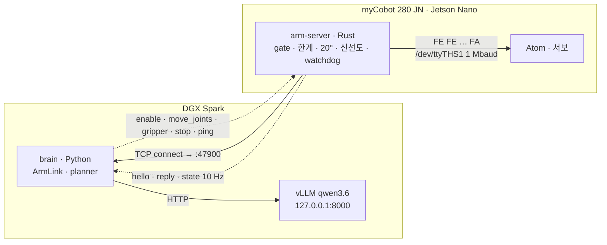

# mycobot-link

DGX Spark(vLLM)와 myCobot 280 JN을 ROS 없이 잇는 프로젝트입니다. 두 프로그램으로 나뉩니다.

| 위치 | 디렉터리 | 언어 | 역할 |
| --- | --- | --- | --- |
| DGX Spark | `brain/` | Python (표준 라이브러리만) | vLLM에 동작을 묻고, 스킬 요청을 보내고, 팔 상태를 받는다 |
| Jetson Nano | `arm-server/` | Rust | 모든 안전 검사를 하고, 통과한 명령만 `/dev/ttyTHS1`로 보낸다 |



Jetson이 Spark에 접속하고(공유기 NAT 때문), 그 연결 하나로 명령·응답·상태가 오갑니다. 메시지 형식은 [`schema/PROTOCOL.md`](schema/PROTOCOL.md)에 있습니다.

핵심 원칙은 세 가지입니다.

- **기본은 dry-run입니다.** 팔 서버는 `--live`를 주고 `yes`를 입력해야만 실제 팔에 명령을 보냅니다.
- **안전 판단은 팔 서버가 합니다.** 관절 한계, 측정값에서 20° 넘는 이동, 속도 상한, 측정값 노화를 팔 서버가 매번 검사합니다. vLLM의 출력과 두뇌 쪽 검사는 제안일 뿐입니다.
- **두뇌가 조용해지면 팔이 멈춥니다.** gate가 열린 동안 두뇌에게서 500 ms 동안 아무 메시지도 오지 않으면 팔 서버가 `stop()`하고 gate를 닫습니다.

## 빠른 시작 (한 PC, dry-run)

터미널 1에서 팔 서버를 띄웁니다. 두뇌가 뜰 때까지 1초마다 다시 접속합니다.

```bash
cd arm-server && cargo run -- --brain 127.0.0.1:47900
```

터미널 2에서 두뇌 명령을 보냅니다. 명령마다 새로 bind하고 팔 서버가 다시 접속하길 기다립니다. dry-run 팔은 목표로 순간이동만 합니다.

```bash
cd brain && uv sync --extra dev
uv run mycobot-brain --host 127.0.0.1 status
uv run mycobot-brain --host 127.0.0.1 move-joints 10 0 0 0 0 0
uv run mycobot-brain --host 127.0.0.1 move-joints 40 0 0 0 0 0   # 측정값 10°에서 30° → 거부
```

## Spark와 Jetson에서

Jetson 바이너리는 두 가지 방법으로 만들 수 있습니다. 연구실 Nano에는 `cargo`가 있어서 그 자리에서 빌드하면 약 1분 걸립니다(2026-10-27 실측).

```bash
cd arm-server && cargo build --release --locked
```

다른 PC에서 정적 musl 바이너리를 만들어 옮길 수도 있습니다. 이 바이너리는 Jetson의 glibc(2.31)와 무관합니다. Nano에는 `gh`가 없어서 release `v0.1.0`의 바이너리를 바로 받을 수는 없습니다.

```bash
cd arm-server
rustup target add aarch64-unknown-linux-musl
cargo build --release --target aarch64-unknown-linux-musl
scp target/aarch64-unknown-linux-musl/release/mycobot-arm <jetson>:~/
```

```bash
# Spark: 두뇌. vLLM이 떠 있어야 ask가 동작한다
cd brain && uv sync
uv run mycobot-brain status
uv run mycobot-brain ask "베이스를 왼쪽으로 조금 돌려"             # 제안만 출력
uv run mycobot-brain ask "베이스를 왼쪽으로 조금 돌려" --execute   # 제안을 팔 서버로 보냄
```

```bash
# Jetson: 팔 서버. 처음에는 dry-run으로 연결만 확인한다
./mycobot-arm --brain 210.123.42.157:47900
./mycobot-arm --brain 210.123.42.157:47900 --live   # 실제 팔. yes 입력 필요
```

`--live`는 vendor ROS 노드·`mycobot-control`과 같은 `/tmp/mycobot_lock`을 잡습니다. 따라서 이들과 동시에 실행할 수 없습니다.

## 검증 상태 (2026-10-27)

- 확인함: 팔 서버의 직렬 프레임 11종이 pymycobot 4.0.7이 실제로 쓰는 바이트와 같고, `get_angles` 응답도 pymycobot과 같은 값으로 읽힘(`arm-server/tests/golden.rs`, pty 녹화). Rust 테스트 28개, Python 테스트 32개(실제 Rust 서버와의 dry-run 연동 포함). aarch64 정적 바이너리가 Spark에서 실행되고 두뇌 CLI와 dry-run으로 연결됨.
- 확인함 (실제 네트워크, dry-run): Jetson Nano(eth0 `192.168.0.77`, 공유기 NAT 뒤)의 팔 서버가 Spark `:47900`에 접속했습니다. Spark에서 본 접속 주소는 공유기 바깥 주소 `222.111.164.53`이었습니다. status, 5° 이동 수락, 25° 차이 이동 거부가 모두 기대대로 나왔습니다. 요청→응답 왕복은 50회 중앙값 0.88 ms, p90 1.30 ms, 최대 1.70 ms였습니다. 핑을 멈추자 watchdog이 515 ms에 gate를 닫았습니다. 양쪽 로그의 순서가 일치합니다.
- 확인 안 함: 실제 팔(`--live`), vLLM과의 실제 `ask`(2026-10-27 Spark에 vLLM 컨테이너 없음), 펌웨어가 `get_angles`에 응답하는 시간(`--reply-timeout-ms 50`의 근거 없음), Spark 방화벽 설정(sudo 필요; 47900 접속은 됨).

## 다음 단계

1. ~~Jetson에서 dry-run으로 Spark 접속 확인~~ (2026-10-27 통과) → `--live`로 상태 읽기만 확인(`move` 없이 `status`).
2. `get_angles` 응답 시간과 펌웨어의 `send_angles` 응답 여부 측정.
3. 작은 이동부터 실기 시험. 한계 숫자는 `mycobot-control`의 실측값으로 갱신.
4. 카메라 JPEG용 두 번째 연결, 동작 완료 보고.
