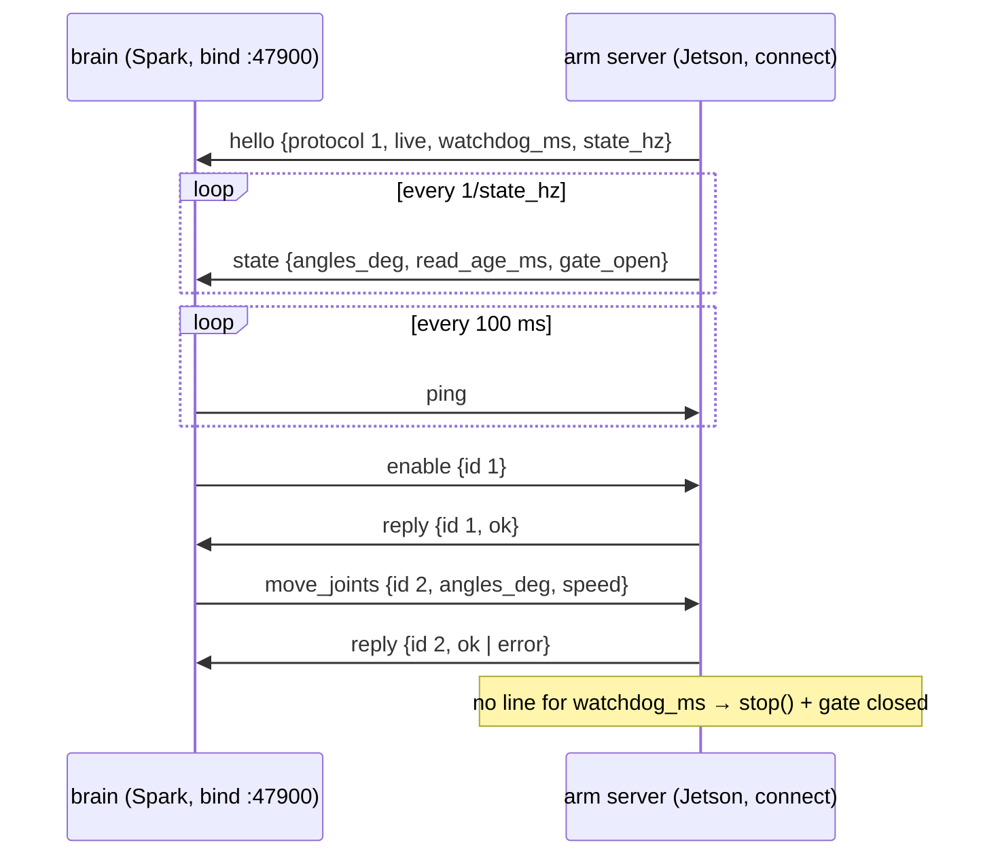

# mycobot-link protocol 1

DGX Spark의 두뇌 프로그램(`brain/`, Python)과 Jetson Nano의 팔 서버(`arm-server/`, Rust)가 주고받는 메시지다. 구조는 [`messages.schema.json`](messages.schema.json)이 정하고, 양쪽 테스트는 [`examples.json`](examples.json)을 함께 읽는다.

## 연결

- **TCP 연결 하나**를 쓴다. 한 줄에 JSON 객체 하나를 보내고(UTF-8, `\n`으로 끝남), 한 줄은 64 KiB를 넘지 않는다.
- **Spark가 bind하고 Jetson이 connect한다.** 기본 포트는 `47900`이다. myCobot은 연구실 공유기 NAT 뒤에 있고 Spark는 캠퍼스 유선망에 있으므로, 바깥으로 나가는 연결이 더 쉽게 열린다. 연결을 거는 방향은 이렇지만 명령은 Spark → Jetson으로 흐른다.
- 팔 서버는 연결이 끊기면 1초마다 다시 연결한다. 두뇌는 새 연결이 오면 이전 연결을 닫는다.
- 명령·응답·상태를 모두 같은 연결로 보낸다. UDP는 NAT를 건너는 방향이 번거롭고, 10 Hz 상태 메시지 정도의 양에서는 TCP 지연이 문제가 되지 않는다(2026-10-23 워크스테이션↔Spark 왕복 중앙값 0.63 ms).



그림 설명: 팔 서버가 접속하자마자 `hello`를 보내고 이후 상태를 주기적으로 보낸다. 두뇌는 100 ms마다 `ping`을 보내며, 요청마다 `id`를 붙여 같은 `id`의 `reply`를 받는다. 두뇌에게서 한 줄도 오지 않은 채 `watchdog_ms`가 지나면 팔 서버가 스스로 멈춘다.

## 메시지

| 방향 | `type` | 응답 | 하는 일 |
| --- | --- | --- | --- |
| brain → arm | `ping` | 없음 | 감시 타이머를 갱신한다. 실제로는 어떤 줄이든 갱신한다 |
| brain → arm | `enable` | `reply` | gate를 연다. 최근 관절 측정값이 없으면 거부한다 |
| brain → arm | `disable` | `reply` | gate를 닫는다. 이미 보낸 이동은 멈추지 않는다 |
| brain → arm | `stop` | `reply` | `stop()`을 보내고 gate를 닫는다. gate가 닫혀 있어도 받는다 |
| brain → arm | `move_joints` | `reply` | 검사를 통과하면 `send_angles(angles_deg, speed)`를 보낸다 |
| brain → arm | `gripper` | `reply` | 검사를 통과하면 `set_gripper_value(value, speed)`를 보낸다 |
| arm → brain | `hello` | — | 접속 직후 한 번. `protocol`이 1이 아니면 두뇌가 연결을 끊는다 |
| arm → brain | `reply` | — | `ok: true`는 **팔로 보냈다**는 뜻이지 도착했다는 뜻이 아니다 |
| arm → brain | `state` | — | 최신값 전용. `angles_deg`가 `null`이면 마지막 읽기가 실패한 것이다 |

`reply.id`는 요청이 너무 망가져서 `id`를 읽을 수 없을 때만 `null`이다.

## 팔 서버의 검사

마지막 권한은 팔 서버에 있다. 두뇌의 JSON schema 검사는 형식만 거르고, 아래 검사는 팔 서버가 매번 다시 한다. 숫자는 `mycobot-control`의 `safety/limits.py`에서 가져왔다.

- **gate:** `enable`로 열고, `disable`·`stop`·감시 타이머·측정값 노화·직렬 오류로 닫힌다. 닫힌 상태에서는 `stop`만 받는다.
- **관절 한계:** pymycobot 4.0.7 `robot_info.py` 표에서 3°를 뺀 범위 밖이면 거부한다.
- **이동량:** **측정한** 관절각에서 20°를 넘게 뛰는 목표는 거부한다. 잘라서 보내지 않고 거부한다. 이렇게 큰 차이는 보통 rad/deg 혼동이나 오래된 측정값에서 나온다.
- **신선도:** 측정값이 `--max-read-age-ms`(기본 300 ms)보다 오래되면 `enable`·`move_joints`를 거부한다. gate가 열린 동안 측정값이 그만큼 오래되면 `stop()`하고 gate를 닫는다.
- **속도:** `move_joints`는 `--max-speed`(기본 50) 이하만 받는다. 50은 `mycobot-control`이 `--allow-fast`를 요구하는 경계다.
- **감시 타이머:** gate가 열린 동안 두뇌에게서 `--watchdog-ms`(기본 500 ms) 동안 한 줄도 오지 않으면 `stop()`하고 gate를 닫는다. 다시 움직이려면 두뇌가 `enable`을 보내야 한다.
- **연결 끊김과 종료:** 연결이 끊기거나 Ctrl-C로 끝날 때는 gate 상태와 상관없이 `stop()`을 보낸다.

## 카메라 연결

- **두 번째 TCP 연결**이다. 640×480 JPEG 한 장이 수십 KB라 팔 연결에 섞으면 그 뒤의 `stop` 응답이 밀린다.
- 방향은 팔과 같다. Spark가 `47901`에 bind하고, Jetson의 `camera-push/camera_push.py`가 접속하고, 끊기면 1초마다 다시 접속한다. 두뇌는 새 연결이 오면 이전 연결과 그 연결의 마지막 프레임을 버린다.
- 데이터는 Jetson → Spark 한 방향뿐이다. 먼저 `hello` 한 줄을 보내고, 이후 프레임마다 머리 한 줄과 그 바이트 수만큼의 JPEG를 보낸다.

```text
{"type":"hello","protocol":1,"server":"camera-push","source":"/dev/video0","size":"640x480","rate_hz":5.0}\n
{"type":"frame","seq":1,"jpeg_bytes":41234,"sent_unix_ms":1761600000000}\n<41234 bytes: FF D8 … FF D9>
```

- 머리 줄은 4 KiB, JPEG는 4 MiB를 넘지 않는다. `FF D8`로 시작하지 않거나 크기가 맞지 않으면 두뇌가 연결을 끊는다.
- **프레임 나이는 Spark에서 잰다.** 마지막 바이트가 도착한 시각(`time.monotonic()`)부터다. 그래서 `sent_unix_ms`는 기록용이며 두 기계의 시계가 달라도 상관없다. `act`는 팔이 멈춘 뒤에 도착한 프레임만 쓴다.
- Jetson 쪽은 ffmpeg가 카메라(MJPG)를 읽어 `rate_hz`마다 한 장을 JPEG로 다시 인코딩한다. 그래서 프레임마다 Huffman 표가 들어 있어 어디서나 디코딩된다. 직렬 포트는 열지 않으므로 팔 서버와 함께 실행된다.

## 아직 정하지 않은 것

- **도착 보고:** `reply`는 수락·거부만 알린다. 도착 여부는 `state`의 관절각으로 판단한다.
- **펌웨어 응답:** 펌웨어가 `send_angles`·`stop`에 응답 프레임을 보내는지 확인하지 않았다. pymycobot 4.0.7 `MyCobot280`은 `stop`·`set_fresh_mode`까지 포함한 동기 호출마다 같은 명령 바이트의 응답을 0.5 s 기다리고, 응답이 없으면 같은 프레임을 다시 보내 **모두 3번** 쓴다(`tools/golden_frames.py`로 pty에서 실측). 팔 서버는 명령을 한 번만 보내고 응답을 기다리지 않는다. 다시 보내면 그것도 명령이 되기 때문이다.
- **인증:** 두뇌 포트에 접속하는 쪽은 명령을 **받기만** 한다. 하지만 가장 최근에 접속한 쪽이 이기므로, 다른 기계가 접속하면 진짜 팔을 끊을 수 있다. 카메라 포트도 같다. 다른 기계가 가짜 프레임을 보내면 vLLM이 그 그림을 보고 동작을 제안한다(팔 서버의 검사는 그대로 적용된다). 공용망에 열기 전에 토큰이나 SSH 터널을 붙인다.
